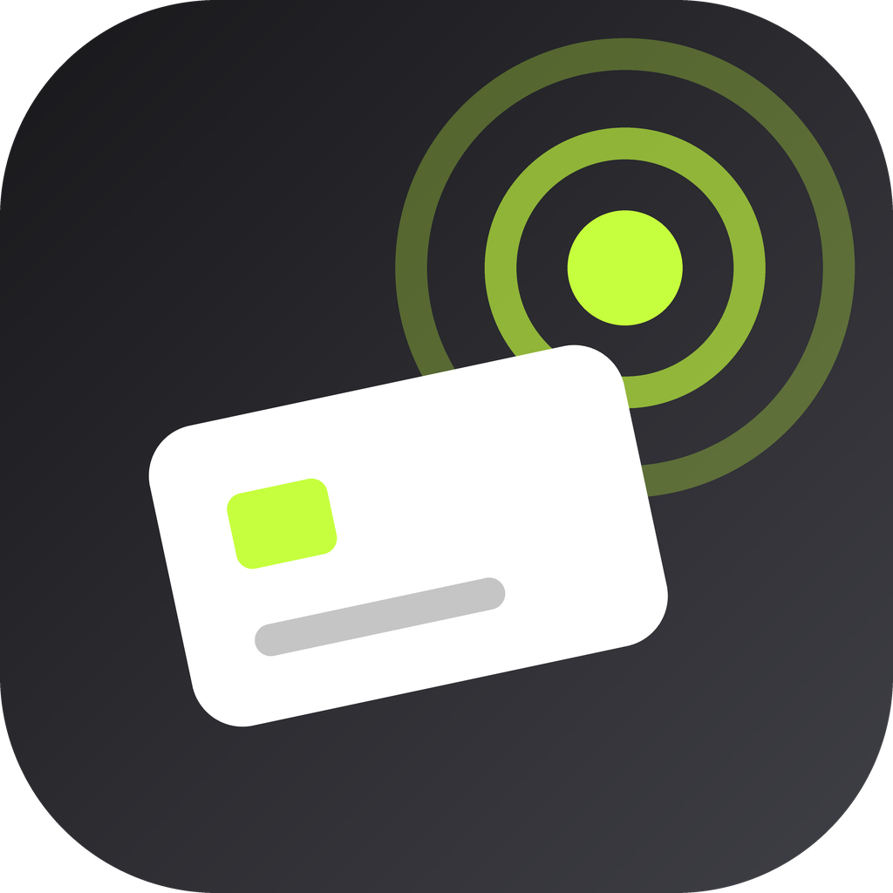
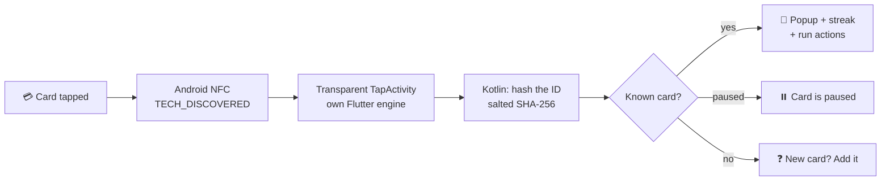

<div align="center">



# tapsy

### Tap. Pop. Done. ⚡

**Turn the cards already in your wallet into magic buttons.**
Tap one on the back of your phone and something happens. Even when the app is closed.


</div>

---

## 🪄 What is this?

Remember iPhone Shortcuts' NFC automations? **Tapsy brings that to Android, with style.**

Grab any NFC card you already own: a metro card, an office ID, a debit card, a cheap sticker.
Register it once, give it a message and some actions, and from then on:

> 📱 **Tap the card → a slick popup flies in → your stuff just happens.**

No unlocking, no hunting for the app, no menus. Just *tap*.

## ✨ What can a tap do?

| | Action | Example |
|---|---|---|
| 💬 | **Show a message** | "Medicine taken ✔︎ See you tomorrow." |
| 📲 | **Open any app** | Gym card → Spotify workout playlist |
| 🔗 | **Open a link** | Desk card → your standup doc |
| 📞 | **Call someone** | Opens the dialer, *you* press call |
| 💚 | **WhatsApp someone** | Pre-typed "On my way!", *you* press send |
| 🧭 | **Navigate** | Car card → directions home |
| 🔦 | **Flashlight** | Toggle, on or off, with no camera permission needed |
| 📋 | **Copy text** | Your UPI ID, ready to paste |
| ⏱️ | **Start a timer** | Tea card → 4-minute brew timer |

Stack up to **8 actions** per card. Quick ones fire first; anything that opens an app waits for a
cancellable 1.8 s countdown, so you always get a beat to change your mind.

### 🕐 Cards that know what time it is

Each action can run **only in the morning, afternoon, evening or at night**, on **weekdays or
weekends**. One desk card opens Slack at 9 am and YouTube at 9 pm. Same card, different vibe.

### 🔥 Streaks

Every card keeps a **daily streak**. Tap your Medicine card every day and watch the 🔥 grow.
Hit 3, 7, 14, 30, 50, 100 days… and the popup throws you a **confetti party**. 🎉
A 7-day dot strip shows your week at a glance.

### 🎨 Make it yours

- **14 card designs**: Midnight, Aurora, Holo, Steel, Carbon, Sunset, Ocean, Neon, Galaxy, Rose,
  Gold, Lava, Forest, Mono
- **24 stickers** to slap on your card 🏋️ 🚗 ☕ 🌙 💊 🚀
- **6 live effects**: tilt-reactive shine, **holo foil** that shifts as you move the phone,
  twinkling **sparkle**, breathing **glow**, sweeping **shimmer**, or none
- **8 templates** (Gym, Focus, Bedtime, Medicine, Car, Torch, Morning, Tea) to go from zero to
  automation in one tap

### 💅 The feels

- Apple Wallet-style **card stack**: swipe the front card to shuffle, tap one to rise, tap
  again to **flip it** and see its stats
- A **ripple** bursts from where the card touched the phone, and the card **flies into the popup**,
  turning over as it lands
- Actions **tick off one by one** with spring-loaded checkmarks and haptics
- Cards **tilt in 3D** under your finger and catch light from the accelerometer
- **Midnight lime** dark theme with the Sora typeface
- Respects Android's *Remove animations* setting, so everything still works with motion off

## 🔐 Paranoid by design

Tapsy works with **bank cards** and treats that with respect.

- 🚫 **No payment data, ever.** No card numbers, expiry dates, CVVs or PINs are read or stored.
  Tapsy never sends commands (APDUs) to the card.
- 🧂 **The raw card ID never leaves native code.** Dart only sees a *salted, truncated SHA-256
  fingerprint* that's meaningless outside this one install.
- ✍️ **Nothing is ever written to your cards.**
- 🔒 **Encrypted at rest** with an AES-256-GCM key in the **Android Keystore**.
- 👆 **Biometric app lock** plus **secret cards** whose message only shows after fingerprint,
  face or PIN. Screenshots are blocked while a secret is on screen.
- 📵 **No backend, no analytics, no accounts.** Android backup is disabled, so your setup stays on
  your phone.
- 🧠 **Honest about limits:** a card ID is a convenient trigger, **not** a security key. IDs can be
  copied, so never use Tapsy as a door lock or for authentication.
- ✋ Calls and WhatsApp messages are **never sent automatically**; you always press the button.
  Only `https://` links are opened.

## 🧬 How it works



- **Two Flutter entry points:** the main app, and `tapMain`, which runs inside a transparent
  Android activity so the popup appears *over whatever you were doing*.
- **Reader mode** for scanning in-app; a `TECH_DISCOVERED` intent filter for taps when the app is
  closed.
- **Registration needs two taps** with the same ID, which proves the card can be recognised later
  and rejects cards that randomise their ID.
- Platform channels: `nfcpin/nfc` (MethodChannel) and `nfcpin/nfc_events` (EventChannel).

## 🛠️ Tech stack

| Layer | What |
|---|---|
| UI | Flutter 3.44 · Dart 3.12 (patterns, records, null-aware elements) · Material 3 |
| Motion | `flutter_animate` · custom `CustomPainter` effects · `sensors_plus` for tilt |
| Native | Kotlin · Android NFC reader mode · CameraManager torch · intents |
| Security | Android Keystore AES-256-GCM · `local_auth` biometrics · `FLAG_SECURE` |
| Storage | Encrypted JSON files with atomic writes, all on device |
| Quality | 99 unit and widget tests · `flutter_lints` |

## 🚀 Run it

You need Flutter 3.44+, an Android phone with NFC, and USB or wireless debugging turned on.

```bash
flutter pub get
```

```bash
flutter run
```

```bash
flutter test
```

Then: **Add card → tap your card twice → pick a template → Save → lock your phone → tap. ✨**

## 🗂️ Project map

```
lib/
├── app/            theme (Midnight lime) and app shell
├── features/
│   ├── actions/    what a tap can do, plus the editor
│   ├── cards/      models, streaks, templates, wallet stack, card designs
│   ├── nfc/        platform channel and compatibility check
│   ├── security/   biometric lock
│   ├── settings/   settings screen
│   ├── onboarding/ first-run screens
│   └── tap/        the popup that shows over other apps
└── shared/         motion, haptics, effects, encryption
android/app/src/main/kotlin/com/dfx/nfcpin/
├── NfcBridge.kt    NFC, hashing, channels
├── CardActions.kt  apps, links, torch, timers, contacts
└── TapActivity.kt  the see-through popup activity
```

## 🗺️ Roadmap

- [x] NFC compatibility check and two-tap card registration
- [x] Popup over any screen, even with the app closed
- [x] Wallet-style animated UI, 14 designs, effects and stickers
- [x] Biometric lock, secret cards and encrypted storage
- [x] Actions: apps, links, calls, WhatsApp, maps, torch, clipboard, timers
- [x] Time-of-day actions, streaks and templates
- [ ] Write-your-own NFC stickers (blank NDEF tags only)
- [ ] Home-screen widget and Quick Settings tile
- [ ] Password-protected backup and restore
- [ ] Hindi, Urdu and Tamil translations

---

<div align="center">

**Made with ⚡, ☕ and a lot of tapping.**

*If Tapsy made you go "ooh", drop a ⭐*

</div>
